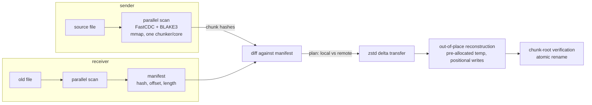

<div align="center">

# ffsync

**Fast chunk-level file sync for big files and fast links.**

ffsync transfers the difference between two files, not the files. It is rsync's
behavior — minimal bytes on the wire, resumable, verified — built on a modern
engine: parallel content-defined chunking, BLAKE3 hashing, zstd compression,
and a hand-rolled, dependency-light wire protocol. No daemon, no config, two
commands.

[](LICENSE-MIT)
[](https://www.rust-lang.org)
[](CHANGELOG.md)
[](https://crates.io/crates/ffsync)
[](https://docs.rs/ffsync)
[](https://github.com/bennischober/ffsync/actions/workflows/ci.yml)

</div>

> **Status: v1.1.0 (stable).** Single-file **and directory-tree** sync between two
> peers over TLS work end-to-end, including resume after mid-transfer
> disconnects. Trees sync by metadata triage (D17): only changed files get
> conversations, synced files adopt the sender's mtime, and a run with
> nothing changed reads metadata only. Deletions of receiver-only files
> apply after every transfer succeeded, opt-out with `--no-delete`.
> Exclude patterns filter tree sessions (§16.7). Parallel per-file
> conversations (`--parallel K`, §16.8) cut WAN sync time by the connection
> count; QUIC transport (`--quic`, §17) puts K conversations on one
> connection with stream-level loss recovery; tree sync carries POSIX
> mode bits (§16.9, D18). See [roadmap](#roadmap) below.

## Why

rsync is battle-tested, but its per-file scan is single-threaded: the sender
computes a rolling checksum over every byte on one core. On large files that
means a long "cold start" of disk-grinding, network-silent hashing before the
first byte moves — and rsync pays that cost again on every run.

Measured during development on a 72.7 GiB file (SATA SSD, ~550 MB/s):

| | Cold start | Effective throughput |
|---|---|---|
| rsync 3.1.3 | ~15 min | ~85 MB/s (single core) |
| ffsync scan | ~242 s | ~320 MB/s (disk-bound, all cores) |

That is a **~3.8x faster cold start**, and the gap widens on faster hardware:
BLAKE3 is SIMD-parallel while rsync's checksum work is not.

Memory stays flat while files grow: chunk data is never copied — the file is
memory-mapped and hashed in place, channels carry `(offset, length)` with
backpressure, and the receiver writes positionally from a reused buffer. A
1 GiB sync peaks at ~3–7 MiB of heap (measured,
[`evaluation/memory.md`](evaluation/memory.md)); all sync state is O(chunks),
~130 B per chunk — a 70 GiB movie syncs on roughly 35 MiB of RAM. Trees add
~90 B per path; 10× the files does not move the needle.

The honest niche: sync time ≈ max(scan on both peers, transfer). On slow links
transfer dominates and rsync is fine. On **fast links (LAN, 1–10 GbE) with big
files and repeated syncs**, the scan dominates — that is the cost ffsync
attacks. The full reasoning, including where ffsync is *worse* than rsync, is
in [`concept/Positioning.md`](concept/Positioning.md).

## How it works



1. **Scan** — the file is memory-mapped and chunked with FastCDC
   (content-defined boundaries; 64 KiB / 256 KiB / 1 MiB for files at or
   above 16 MiB, 16 KiB / 64 KiB / 256 KiB below — the small-file config
   cuts localized-edit over-send ~4× on small files, D19) on one thread
   per core; every chunk is hashed with BLAKE3 on worker threads. Chunks
   travel through bounded channels as `(offset, length)` — content is
   never copied.
2. **Exchange** — the receiver streams its manifest (chunk hashes); the sender
   diffs and produces a plan: chunks the receiver already has (by exact hash
   match) are named, missing chunks are scheduled for transfer.
3. **Transfer** — missing chunks are zstd-compressed and streamed; the
   receiver executes the plan before the data arrives, reading local chunks
   from its own file (locals-first write order — this is what makes resume
   work).
4. **Verify and commit** — the reconstructed file is re-scanned, its
   chunk-tree root (a domain-separated BLAKE3 over the ordered chunk hashes)
   must equal the sender's, and only then does a temp file atomically replace
   the target. A wrong byte anywhere fails loudly, never silently.
5. **Warm start (after the first sync)** — each side persists a per-file
   chunk index (`<file>.ffsync-index`) at commit time, holding the chunk
   list, root, and CDC parameters it just verified. On the next sync, a
   peer whose file still matches the index (size + mtime at nanosecond
   granularity, plus the same chunking parameters — D19) skips the scan
   entirely and serves its manifest/plan from the index — repeated syncs
   of unchanged data become stat-only operations. rsync rescans
   everything from scratch on every run; this is the memory rsync does
   not have. Corrupt indexes are rejected at load (the decoder re-derives
   the chunk root); a stale-but-validating index fails loudly and is
   dropped, so a retry cold-scans — wrong content can cost an error,
   never a silent mismatch.

6. **Tree mode (v0.3)** — a directory path switches from one file to a
   whole tree: both peers exchange manifests of `(relative path, kind, size,
   mtime)` (metadata only, no contents), triage locally and identically,
   and then run the per-file machinery above — sequentially, over the same
   connection — for exactly the files that need it. Matching files are
   skipped without a byte of I/O; synced files adopt the sender's mtime so
   the next run skips them again. Files only the receiver has are deleted
   last, after every transfer succeeded (`--no-delete` keeps them).

The wire protocol is specified in
[`concept/Protocol v0.1.md`](concept/Protocol%20v0.1.md): 15 frame types,
length-prefixed, no protobuf.

## Built on

| Component | Role | Why this one |
|---|---|---|
| [FastCDC](https://github.com/nlfiedler/fastcdc-rs) (`fastcdc` v2020) | Content-defined chunking | Cut points survive insertions/deletions; chunks stay self-identifying across file versions |
| [BLAKE3](https://github.com/BLAKE3-team/BLAKE3) | Chunk + tree hashing | Extremely fast (SIMD, multi-threaded), one primitive for chunk IDs, verification, and the file identity |
| [zstd](https://github.com/facebook/zstd) | Chunk compression | Measured best ratio/speed trade-off for chunk-sized payloads |
| [memmap2](https://github.com/RazrFalcon/memmap2-rs) | File I/O | Zero-copy slicing for hash workers; no read() syscalls per chunk |
| [crossbeam](https://github.com/crossbeam-rs/crossbeam) | Bounded channels | Backpressure between chunkers and hash workers on native threads; no async runtime in the data plane |
| [rustls](https://github.com/rustls/rustls) + [ring](https://github.com/briansmith/ring) | Transport security (D16) | TLS 1.3 as a thin `Read + Write` wrapper around TCP; the audited, mainstream Rust choice — no hand-rolled channel crypto |
| [rcgen](https://github.com/rustls/rcgen) | Identity certs | Generates the self-signed peer certificate on first run |
| rsync (comparison only) | Baseline | The tool this project is measured against, and its delta algorithm is respected, not wrapped |

Design decisions and their alternatives are recorded in
[`concept/Design Decisions.md`](concept/Design%20Decisions.md) (D1-D19).

## Using it

Install (fastest routes first for most users):

```bash
# 1. Download a prebuilt executable from the releases page (Windows zip,
#    Linux tar.gz; SHA-256 sidecars included) - no toolchain needed:
#    https://github.com/bennischober/ffsync/releases/latest

# 2. From crates.io (needs a Rust toolchain):
cargo install ffsync

# 3. From the repository (tracks main):
cargo install --git https://github.com/bennischober/ffsync
```

Package-manager routes (winget, Homebrew) are not set up yet — the
prebuilt executables and `cargo install` are the supported paths.
A Homebrew tap or a winget manifest can be added once there is demand;
the release artifacts (zip/tar.gz with SHA-256 sidecars) are already
shaped for both.

Binaries do not auto-update; new releases are announced on the releases
page. Verify a download against the attached `.sha256` sidecar
(`sha256sum -c ffsync-*.sha256` / `Get-FileHash` on Windows).

Two terminals on the same machine (or LAN - replace `127.0.0.1` with the
receiver's address):

```bash
# Receiver: listen and converge ./big-file.bin from its current state
ffsync receive ./big-file.bin 7788

# Sender: push the (newer) file to the receiver
ffsync send ./big-file.bin 127.0.0.1:7788
```

**Directory trees** (v0.3) — pass a directory instead of a file; the
*contents* of the directory sync into the destination directory (`dir` and
`dir/` are the same thing, no rsync trailing-slash semantics):

```bash
# Receiver: converge ./photos toward the sender's tree
ffsync receive ./photos 7788

# Sender: push the whole tree
ffsync send ./photos 127.0.0.1:7788
```

Tree mode syncs files whose size or modification time differs, creates
missing directories (including empty ones), and **deletes** files that
exist only on the receiver — the sender's tree is authoritative, like
`rsync --delete`. Pass `--no-delete` on receive to keep receiver-only
files; deletions apply only after every transfer succeeded (a failed sync
never destroys data). Because synced files carry the sender's mtime, a
second run with nothing changed reads metadata only — no hashing, no
transfer, a handful of frames.

**Exclude patterns** keep paths out of a tree session entirely — never
transferred, never deleted, never reported:

```bash
# Sender: sync the tree but not build output or caches (repeatable)
ffsync send ./project 127.0.0.1:7788 --exclude target/ --exclude "*.log" --exclude node_modules

# Receiver: patterns from a file; they also protect matching paths from deletion
ffsync receive ./project 7788 --exclude-from ./ffsync-excludes.txt
```

Grammar: `*` and `?` never cross `/`; `**` as a whole segment matches any
depth; `[a-z]`/`[!a-z]` are character classes; a pattern containing `/`
matches from the tree root, without it matches the basename at any depth;
a trailing `/` restricts to directories. A leading `!` **re-includes**
(negation, v0.7.1): patterns are evaluated in the order given and the
first match decides — `!keep.log` before `*.log` syncs every log except
`keep.log`. A negation cannot reach inside a pruned directory; exclude
the children (`target/*`, negation first) instead of the directory
(`target/`). The sender's patterns rule the
session (they travel in the protocol, so both peers filter identically);
a receiver's own patterns additionally protect matching paths - and
everything under an excluded directory - from deletion (e.g. keep local
`secrets/` while syncing everything else).

**Parallel tree sessions** (`--parallel <K>`, 2..=16) run per-file
conversations over K connections at once:

```powershell
# Sender: 4 connections; the receiver accepts them automatically.
ffsync send ./project 192.168.1.20:7788 --parallel 4
```

Each connection authenticates with the same TLS fingerprint pinning; a
failed conversation fails the whole session and the receiver deletes
nothing. On a WAN the wall-clock saving is roughly the connection count
(measured: 3.4× at K=4, 6.1× at K=8 on a 100-file transfer at 30 ms RTT);
on a LAN it changes little (the metadata scan already dominates there).

**QUIC transport** (`--quic`, opt-in; TCP stays the default) puts the
whole session on one QUIC connection: in tree mode the parallel
conversations ride QUIC streams instead of separate TCP connections, so
K connections collapse into one TLS 1.3 handshake, a lost packet delays
only its own stream (no TCP head-of-line blocking between conversations),
and the connection survives a changing peer address (Wi-Fi → hotspot).
The same identity and pins are used — a pinned peer may connect over
either transport. QUIC has no plaintext mode; `--plaintext` + `--quic`
is rejected. QUIC needs UDP; on UDP-blocked paths the handshake times
out with a hint to use TCP.

```powershell
# Sender over QUIC; the receiver listens on UDP with the same port syntax.
ffsync send ./project 192.168.1.20:7788 --quic --parallel 4
```

**Transport security is on by default** (D16): both peers generate a
self-signed certificate on first run and authenticate each other by
fingerprint. On first contact each side prints the peer's fingerprint and
asks `trust this peer? [y/N]`; compare it out-of-band (in person, chat,
whatever you would use to exchange a key), confirm once, and every later
sync verifies silently. A fingerprint mismatch refuses loudly and syncs
nothing. For scripts, pass `--trust <fingerprint>` instead of the prompt;
`ffsync trust <fingerprint>` / `ffsync untrust <fingerprint>` /
`ffsync fingerprints` manage the pins (`pins.conf` in the ffsync state
directory - no usernames, no passwords, no secrets on disk). Use
`--plaintext` for trusted LANs or inside an SSH tunnel.

**Dry run** (`--dry-run`, send side): preview a session with zero
mutation - the receiver runs triage only, reports what would transfer and
what would be deleted, and never writes (rsync `-n` semantics). The first
sync to a new peer can be rehearsed on real data; both peers print
"WOULD CHANGE (dry run - nothing was written)" and the would-delete
counts. Old ffsync peers reject the flag loudly instead of syncing.

**Eager diff** (`--eager`, single-file and tree, both peers): start moving bytes
during the scan instead of after it. The sender streams chunk DATA as soon
as the receiver's manifest proves the chunk missing (bounded by a position
gate — over-send stayed 0 bytes in the paired bench runs), overlapping the
scan and transfer phases: 18-33% faster at 0 ms RTT, 12-18% faster at
30 ms RTT on the 128 MiB modified fixture. Both peers need the flag; in tree mode a
declining receiver converges lazily instead. A single-file peer that
declines fails the session loudly instead of hanging.

Flags: `--checksum` disables the mtime/size fast path *and* the warm-start
index (rsync `-c` semantics - always compare chunk roots; in tree mode it
applies to every file); receiver-side (single-file) `--from <old-file>`
reads the local chunks from a different file than the target. If the
connection drops mid-transfer, the receiver keeps its partial state;
rerunning the same two commands **resumes** - for a single file, the
receiver re-scans its temp file, unions it with the old file, and only the
genuinely missing chunks cross the wire; for a tree, files already synced
before the drop match in metadata and are skipped, so a rerun continues
where the session died (plus the interrupted file's per-file resume).
After a successful sync, both peers keep `<file>.ffsync-index` sidecars;
the next run of an unchanged file shows
`warm loaded N chunks from index, scan skipped` instead of a hashing phase.
Deleting the index file (or the file itself, whose orphaned index is cleaned
up automatically) always falls back to a full cold scan.

Two known limitations: a file that is **open for writing on the receiver**
(antivirus scan, media player) blocks the final rename with a sharing
violation — the error is loud, nothing is corrupted, and a retry after the
file closes succeeds; and `ffsync` syncs **file content, size, mtime, and
POSIX mode bits** — other metadata (xattrs, alternate data streams,
hardlink identity) is out of scope by design (D9).

Progress is single-line: `hashing → diffing → sending/receiving → verifying`,
with bytes, throughput, and elapsed time per phase. A scan-bound sync says so
instead of being silently disk-busy/network-idle — that silence in rsync is
why this project exists.

## Benchmark

32 MiB fixtures, seeded pseudo-random data, release build, all reconstructions
hash-verified (`cargo run --release --bin bench -- --quick --seed 42 --rsync`):

```
scenario    src scan  tgt scan   missing   delta %   dedup     recon    e2e 1x verified
identical    27.5 ms   25.5 ms       0 B     0.00%     inf   47.0 ms   27.5 ms      yes
modified     29.3 ms   26.8 ms  1.53 MiB     4.79%    20.9x   47.3 ms   42.1 ms      yes
appended     27.6 ms   27.4 ms  3.24 MiB     9.21%    10.9x   51.0 ms   54.8 ms      yes
fresh        27.7 ms   25.1 ms 32.00 MiB   100.00%     1.0x   39.3 ms  296.2 ms      yes
```

A 4.79% modification sends 4.79% of the bytes; identical files cost zero
transfer bytes and one parallel scan. On the same modified scenario, rsync's
delta algorithm (`--no-whole-file` via WSL, same fixtures) sent **667 KiB** —
its fine-grained fixed blocks win on delta ratio for small localized edits.
ffsync's 256 KiB average chunks trade some of that for scan parallelism; the
chunk-size sweep that picked the defaults is in
[`evaluation/rsync.md`](evaluation/rsync.md).

Caveats: 32 MiB is page-cache resident and the fixtures are random data (worst
case for compression, best case for CDC boundary stability). Treat the numbers
as structural, not as your-hardware numbers; the harness reproduces them with
`--size-mib 1024` on real-sized files.

**Tree sessions** (`--tree`, D17): a 40-file / 135 MiB fixture across 6 dirs
run through three simulated sessions — everything transfers when the receiver
is empty, a diverged session moves only the changed bytes, and the warm
unchanged session is stat-only:

```
session 1 (receiver empty)   scan 0.9 ms   40 conversations   135.0 MiB transferred
session 2 (diverged, cold)   scan 1.5 ms   15 conversations   17.44 MiB transferred (54.5% of touched files)
session 3 (unchanged, warm)  scan 1.5 ms    0 conversations    0 B transferred
```

The unchanged session skips hashing entirely (mtime preservation at commit
makes the metadata fast path hold tree-wide); the diverged session deletes
receiver-only files only after every conversation succeeded. Measured details
in [`evaluation/chunking.md`](evaluation/chunking.md).

## Building and benchmarking

```bash
cargo build --release
cargo test
cargo run --release --bin bench -- --quick          # fast run (32 MiB)
cargo run --release --bin bench -- --size-mib 1024  # 1 GiB, stresses the pipeline
cargo run --release --bin bench -- --tree --seed 42 # tree sessions (D17)
cargo run --release --bin bench -- --quick --rsync  # also time rsync (native or WSL)
cargo audit                                          # dependency advisory check
```

Release executables are built by the tag-driven release workflow and
attached to the GitHub release with a SHA-256 sidecar each:
`ffsync-vX.Y.Z-windows-x64.zip`, `ffsync-vX.Y.Z-linux-x64.tar.gz`,
`ffsync-vX.Y.Z-linux-arm64.tar.gz`, `ffsync-vX.Y.Z-windows-arm64.zip`.
Windows builds use MSVC with a static CRT (no VC++ redistributable
needed); Linux builds are musl and fully static — one binary per
architecture runs on any distro. (Asset names are friendly platform
labels; the Rust target triples are a build detail of the workflow.)

Requires a stable Rust toolchain (developed on 1.99, edition 2024). Windows is
the primary development platform; the I/O layer is `#[cfg]`-split for Unix.

## Project layout

```
src/
  chunking/       the pipeline: mmap -> FastCDC chunkers -> BLAKE3 hash workers
  reconstruction/ out-of-place rebuild: temp file, positional writes, verify, rename
  protocol/       wire protocol: framing, messages, state machines, tree sessions
  tree.rs         tree scan, path validation, triage (D17)
  index.rs        persistent chunk index (warm starts): codec, validate, atomic write
  transport/       TLS + fingerprint pinning (D16), QUIC carrier (D13 step 2)
                 (transport/quic.rs: quinn streams as sync Read + Write)
  main.rs         the CLI
  bin/bench.rs    the benchmark harness
fuzz/             cargo-fuzz targets over the wire decoders (hostile input)
concept/          design docs (positioning, decisions, protocol spec, research)
evaluation/       measured results (chunking, rsync, parallel, tool comparison, memory)
```

## Design docs

The reasoning is the product; it is all recorded:

- [`concept/Positioning.md`](concept/Positioning.md) — why this exists, the
  niche, why "build around rsync" does not work
- [`concept/Design Decisions.md`](concept/Design%20Decisions.md) — D1–D17 with
  alternatives and rejected options
- [`concept/Protocol v0.1.md`](concept/Protocol%20v0.1.md) — the wire protocol
  (tracks all versions; currently v4), frame by frame
- [`concept/Deep Research Digest.md`](concept/Deep%20Research%20Digest.md) —
  what the two deep-research runs got right, and what was rejected
- [`evaluation/chunking.md`](evaluation/chunking.md),
  [`evaluation/rsync.md`](evaluation/rsync.md),
  [`evaluation/parallel.md`](evaluation/parallel.md),
  [`evaluation/comparison.md`](evaluation/comparison.md) and
  [`evaluation/memory.md`](evaluation/memory.md) — the measurements
  behind the defaults (comparison.md: ffsync vs rsync/croc/sendme
  head-to-head on loopback, every cell hash-verified; chunking.md also
  holds the real-content corpus results and the F2 chunker A/B test
  that closed without an adoption)

## Roadmap

- **Done (0.2.0) - transport security (D16):** TLS 1.3 by default,
  mutual authentication by self-signed-cert fingerprint pinning (TOFU with
  an out-of-band compare on first contact); `--plaintext` keeps LAN/SSH
  tunnels. QUIC is deferred until measurement shows parallel streams
  worthwhile (D13 amendment).
- **Done (0.2.0) - persistent chunk index (warm restarts, D15):** chunks
  are content-addressed, so a persisted index turns repeated syncs into
  stat-only operations. This is the core product insight; rsync rescans
  everything from scratch every run.
- **Done (0.3.0) - directory-tree sync (D17):** metadata triage over a
  tree, sequential per-file conversations over one connection, mtime
  preservation, deferred deletes with `--no-delete`, empty files/dirs
  first-class.
- **Done (0.4.0) - excludes/pattern matching (§16.7):** `--exclude`
  and `--exclude-from` filter tree sessions; the sender's patterns travel
  in the protocol so both peers filter identically, and a receiver's own
  patterns protect paths from deletion. Negation (`!pattern`,
  first-match-wins) landed in 0.7.1 (§16.7 v0.7.1).
- **Done (0.5.0) - parallel per-file conversations (§16.8, D13 step
  1):** `--parallel K` spreads a tree session's conversations over K
  connections (native threads, no async); measured 3.4×–6.1× on a
  100-file full transfer at 30 ms simulated RTT
  (`evaluation/parallel.md`). QUIC (one connection,
  K streams + connection migration) can now slot in as a transport swap.
- **Done (0.6.0) - QUIC transport (D13 step 2, §17):** `--quic`
  puts a whole session on one QUIC connection — tree conversations ride
  QUIC streams instead of separate TCP connections (one handshake
  instead of K), stream-level loss recovery replaces the TCP
  head-of-line block, and connection migration covers changing peer
  addresses. Same identity/pinning model; the state machines stay
  sync (tokio at the transport edge only, D3). TCP/TLS-over-TCP stay
  the default.
- **Evaluated, not adopted (F2, 2026-10-23) - alternative chunkers:**
  SeqCDC / MinCDC / MothCDC benchmarked on the real-content corpus with
  ffsync's own metrics ([`evaluation/chunking.md`](evaluation/chunking.md)):
  MinCDC is 3.6× faster than FastCDC at equal delta quality, but the scan
  is disk-bound cold and a few percent of sync wall time, so the win never
  reaches the user end-to-end; SeqCDC fails edit locality on media (its
  cut rule is chunk-start-relative, so in-place edits re-anchor every
  later boundary); MothCDC is byte-identical to MinCDC on our data. The
  `Chunker` trait keeps swapping cheap; MinCDC is the tracked candidate
  if fast/warm rescans ever become the bottleneck.
- **Done (0.7.0) - POSIX mode bits (§16.9, D18; protocol v4):**
  tree sync carries and applies the sender's permission bits (unix exact,
  Windows via the read-only attribute); mode never triggers syncs (the
  size+mtime fast path is untouched), and the tree scan no longer
  recurses into directory symlinks/junctions (the Windows junction
  recursion hazard). Xattrs/hardlinks/symlink-as-entry stay out of scope
  (D9/D18).
- **Done (0.8.0) - small-file adaptive chunking (D19):** CDC parameters
  are a pure function of file size — below 16 MiB the F1-sweep config
  (16 KiB/64 KiB/256 KiB), otherwise the shipped defaults. Localized
  edits to small files stop dragging whole large chunks to the wire
  (size-ladder sweep: 18.09% → 4.14% delta on an 8 MiB source archive);
  large files chunk byte-identically to before (indexes stay valid).
  HELLO's existing `cdc_min/avg/max` fields carry the values (wire
  layout unchanged); the chunk index records them (`FFSYIX02`) and warm
  starts require a parameter match.
- **Closed (D9 amendment, 2026-10-23) - the metadata remainder:**
  symlink-as-entry, hardlinks, and xattrs are explicitly out of scope with
  recorded reasoning (see D9 in `concept/Design Decisions.md`); the
  follow-or-warn symlink policy and POSIX mode bits are the shipped
  metadata story. D9's deferred metadata list is now empty.
- **Done (1.0.0, post-release) - hardening regressions in CI (PR #15):**
  Windows long-path tree sync (>260 chars) and a real-socket dry-run E2E
  now run on every push; unix commits fsync the parent directory after
  the rename.
- **Done (post-1.0) - eager diff (D8, §9.2/§16.11):** `--eager` streams
  chunk DATA during the manifest exchange, bounded by the position gate
  (over-send 0 bytes in every paired run; 18–33% faster at 0 ms RTT,
  12–18% at 30 ms). Landed for single-file first (PR #16), then tree
  sessions including `--parallel` (PR #18): TREE_BEGIN bit 7, receiver
  mirrors only on its own opt-in, a declining tree receiver converges
  lazily.

## License

Dual-licensed under either of

- Apache License, Version 2.0 ([LICENSE-APACHE](LICENSE-APACHE))
- MIT license ([LICENSE-MIT](LICENSE-MIT))

at your option.
