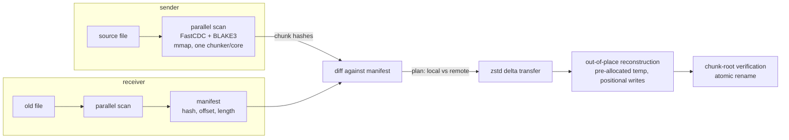

<div align="center">

# ffsync

**Fast chunk-level file sync for big files and fast links.**

ffsync transfers the difference between two files, not the files. It is rsync's
behavior — minimal bytes on the wire, resumable, verified — built on a modern
engine: parallel content-defined chunking, BLAKE3 hashing, zstd compression,
and a hand-rolled, dependency-light wire protocol. No daemon, no config, two
commands.

[](LICENSE-MIT)
[](https://www.rust-lang.org)
[](CHANGELOG.md)
[](https://github.com/bennischober/ffsync/actions/workflows/ci.yml)

</div>

> **Status: v0.3.0-dev (unreleased).** Single-file **and directory-tree**
> sync between two peers over TLS work end-to-end, including resume after
> mid-transfer disconnects. Trees sync by metadata triage (D17): only
> changed files get conversations, synced files adopt the sender's mtime,
> and a run with nothing changed reads metadata only. Deletions of
> receiver-only files apply after every transfer succeeded, opt-out with
> `--no-delete`. Not implemented yet: exclude patterns, parallel streams
> (QUIC). See [roadmap](#roadmap) below.

## Why

rsync is battle-tested, but its per-file scan is single-threaded: the sender
computes a rolling checksum over every byte on one core. On large files that
means a long "cold start" of disk-grinding, network-silent hashing before the
first byte moves — and rsync pays that cost again on every run.

Measured during development on a 72.7 GiB file (SATA SSD, ~550 MB/s):

| | Cold start | Effective throughput |
|---|---|---|
| rsync 3.1.3 | ~15 min | ~85 MB/s (single core) |
| ffsync scan | ~242 s | ~320 MB/s (disk-bound, all cores) |

That is a **~3.8x faster cold start**, and the gap widens on faster hardware:
BLAKE3 is SIMD-parallel while rsync's checksum work is not.

The honest niche: sync time ≈ max(scan on both peers, transfer). On slow links
transfer dominates and rsync is fine. On **fast links (LAN, 1–10 GbE) with big
files and repeated syncs**, the scan dominates — that is the cost ffsync
attacks. The full reasoning, including where ffsync is *worse* than rsync, is
in [`concept/Positioning.md`](concept/Positioning.md).

## How it works



1. **Scan** — the file is memory-mapped and chunked with FastCDC
   (content-defined boundaries, 64 KiB / 256 KiB / 1 MiB by default) on one
   thread per core; every chunk is hashed with BLAKE3 on worker threads.
   Chunks travel through bounded channels as `(offset, length)` — content is
   never copied.
2. **Exchange** — the receiver streams its manifest (chunk hashes); the sender
   diffs and produces a plan: chunks the receiver already has (by exact hash
   match) are named, missing chunks are scheduled for transfer.
3. **Transfer** — missing chunks are zstd-compressed and streamed; the
   receiver executes the plan before the data arrives, reading local chunks
   from its own file (locals-first write order — this is what makes resume
   work).
4. **Verify and commit** — the reconstructed file is re-scanned, its
   chunk-tree root (a domain-separated BLAKE3 over the ordered chunk hashes)
   must equal the sender's, and only then does a temp file atomically replace
   the target. A wrong byte anywhere fails loudly, never silently.
5. **Warm start (after the first sync)** — each side persists a per-file
   chunk index (`<file>.ffsync-index`) at commit time, holding the chunk list
   and root it just verified. On the next sync, a peer whose file still
   matches the index (size + mtime, compared at nanosecond granularity)
   skips the scan entirely and serves its manifest/plan from the index —
   repeated syncs of unchanged data become stat-only operations. rsync
   rescans everything from scratch on every run; this is the memory rsync
   does not have. Corrupt indexes are rejected at load (the decoder
   re-derives the chunk root); a stale-but-validating index fails loudly and
   is dropped, so a retry cold-scans — wrong content can cost an error,
   never a silent mismatch.

6. **Tree mode (v0.3)** — a directory path switches from one file to a
   whole tree: both peers exchange manifests of `(relative path, kind, size,
   mtime)` (metadata only, no contents), triage locally and identically,
   and then run the per-file machinery above — sequentially, over the same
   connection — for exactly the files that need it. Matching files are
   skipped without a byte of I/O; synced files adopt the sender's mtime so
   the next run skips them again. Files only the receiver has are deleted
   last, after every transfer succeeded (`--no-delete` keeps them).

The wire protocol is specified in
[`concept/Protocol v0.1.md`](concept/Protocol%20v0.1.md): 14 frame types,
length-prefixed, no protobuf.

## Built on

| Component | Role | Why this one |
|---|---|---|
| [FastCDC](https://github.com/nlfiedler/fastcdc-rs) (`fastcdc` v2020) | Content-defined chunking | Cut points survive insertions/deletions; chunks stay self-identifying across file versions |
| [BLAKE3](https://github.com/BLAKE3-team/BLAKE3) | Chunk + tree hashing | Extremely fast (SIMD, multi-threaded), one primitive for chunk IDs, verification, and the file identity |
| [zstd](https://github.com/facebook/zstd) | Chunk compression | Measured best ratio/speed trade-off for chunk-sized payloads |
| [memmap2](https://github.com/RazrFalcon/memmap2-rs) | File I/O | Zero-copy slicing for hash workers; no read() syscalls per chunk |
| [crossbeam](https://github.com/crossbeam-rs/crossbeam) | Bounded channels | Backpressure between chunkers and hash workers on native threads; no async runtime in the data plane |
| [rustls](https://github.com/rustls/rustls) + [ring](https://github.com/briansmith/ring) | Transport security (D16) | TLS 1.3 as a thin `Read + Write` wrapper around TCP; the audited, mainstream Rust choice — no hand-rolled channel crypto |
| [rcgen](https://github.com/rustls/rcgen) | Identity certs | Generates the self-signed peer certificate on first run |
| rsync (comparison only) | Baseline | The tool this project is measured against, and its delta algorithm is respected, not wrapped |

Design decisions and their alternatives are recorded in
[`concept/Design Decisions.md`](concept/Design%20Decisions.md) (D1-D16).

## Using it

Two terminals on the same machine (or LAN - replace `127.0.0.1` with the
receiver's address):

```bash
# Receiver: listen and converge ./big-file.bin from its current state
ffsync receive ./big-file.bin 7788

# Sender: push the (newer) file to the receiver
ffsync send ./big-file.bin 127.0.0.1:7788
```

**Directory trees** (v0.3) — pass a directory instead of a file; the
*contents* of the directory sync into the destination directory (`dir` and
`dir/` are the same thing, no rsync trailing-slash semantics):

```bash
# Receiver: converge ./photos toward the sender's tree
ffsync receive ./photos 7788

# Sender: push the whole tree
ffsync send ./photos 127.0.0.1:7788
```

Tree mode syncs files whose size or modification time differs, creates
missing directories (including empty ones), and **deletes** files that
exist only on the receiver — the sender's tree is authoritative, like
`rsync --delete`. Pass `--no-delete` on receive to keep receiver-only
files; deletions apply only after every transfer succeeded (a failed sync
never destroys data). Because synced files carry the sender's mtime, a
second run with nothing changed reads metadata only — no hashing, no
transfer, a handful of frames.

**Transport security is on by default** (D16): both peers generate a
self-signed certificate on first run and authenticate each other by
fingerprint. On first contact each side prints the peer's fingerprint and
asks `trust this peer? [y/N]`; compare it out-of-band (in person, chat,
whatever you would use to exchange a key), confirm once, and every later
sync verifies silently. A fingerprint mismatch refuses loudly and syncs
nothing. For scripts, pass `--trust <fingerprint>` instead of the prompt;
`ffsync trust <fingerprint>` / `ffsync untrust <fingerprint>` /
`ffsync fingerprints` manage the pins (`pins.conf` in the ffsync state
directory - no usernames, no passwords, no secrets on disk). Use
`--plaintext` for trusted LANs or inside an SSH tunnel.

Flags: `--checksum` disables the mtime/size fast path *and* the warm-start
index (rsync `-c` semantics - always compare chunk roots; in tree mode it
applies to every file); receiver-side (single-file) `--from <old-file>`
reads the local chunks from a different file than the target. If the
connection drops mid-transfer, the receiver keeps its partial state;
rerunning the same two commands **resumes** - for a single file, the
receiver re-scans its temp file, unions it with the old file, and only the
genuinely missing chunks cross the wire; for a tree, files already synced
before the drop match in metadata and are skipped, so a rerun continues
where the session died (plus the interrupted file's per-file resume).
After a successful sync, both peers keep `<file>.ffsync-index` sidecars;
the next run of an unchanged file shows
`warm loaded N chunks from index, scan skipped` instead of a hashing phase.
Deleting the index file (or the file itself, whose orphaned index is cleaned
up automatically) always falls back to a full cold scan.

Progress is single-line: `hashing → diffing → sending/receiving → verifying`,
with bytes, throughput, and elapsed time per phase. A scan-bound sync says so
instead of being silently disk-busy/network-idle — that silence in rsync is
why this project exists.

## Benchmark

32 MiB fixtures, seeded pseudo-random data, release build, all reconstructions
hash-verified (`cargo run --release --bin bench -- --quick --seed 42 --rsync`):

```
scenario    src scan  tgt scan   missing   delta %   dedup     recon    e2e 1x verified
identical    27.5 ms   25.5 ms       0 B     0.00%     inf   47.0 ms   27.5 ms      yes
modified     29.3 ms   26.8 ms  1.53 MiB     4.79%    20.9x   47.3 ms   42.1 ms      yes
appended     27.6 ms   27.4 ms  3.24 MiB     9.21%    10.9x   51.0 ms   54.8 ms      yes
fresh        27.7 ms   25.1 ms 32.00 MiB   100.00%     1.0x   39.3 ms  296.2 ms      yes
```

A 4.79% modification sends 4.79% of the bytes; identical files cost zero
transfer bytes and one parallel scan. On the same modified scenario, rsync's
delta algorithm (`--no-whole-file` via WSL, same fixtures) sent **667 KiB** —
its fine-grained fixed blocks win on delta ratio for small localized edits.
ffsync's 256 KiB average chunks trade some of that for scan parallelism; the
chunk-size sweep that picked the defaults is in
[`evaluation/rsync.md`](evaluation/rsync.md).

Caveats: 32 MiB is page-cache resident and the fixtures are random data (worst
case for compression, best case for CDC boundary stability). Treat the numbers
as structural, not as your-hardware numbers; the harness reproduces them with
`--size-mib 1024` on real-sized files.

## Building and benchmarking

```bash
cargo build --release
cargo test
cargo run --release --bin bench -- --quick          # fast run (32 MiB)
cargo run --release --bin bench -- --size-mib 1024  # 1 GiB, stresses the pipeline
cargo run --release --bin bench -- --quick --rsync  # also time rsync (native or WSL)
cargo audit                                          # dependency advisory check
```

Requires a stable Rust toolchain (developed on 1.99, edition 2024). Windows is
the primary development platform; the I/O layer is `#[cfg]`-split for Unix.

## Project layout

```
src/
  chunking/       the pipeline: mmap -> FastCDC chunkers -> BLAKE3 hash workers
  reconstruction/ out-of-place rebuild: temp file, positional writes, verify, rename
  protocol/       wire protocol: framing, messages, state machines, tree sessions
  tree.rs         tree scan, path validation, triage (D17)
  index.rs        persistent chunk index (warm starts): codec, validate, atomic write
  transport.rs    TLS + fingerprint pinning (D16)
  main.rs         the CLI
  bin/bench.rs    the benchmark harness
concept/          design docs (positioning, decisions, protocol spec, research)
evaluation/       measured results (chunking, rsync comparison)
```

## Design docs

The reasoning is the product; it is all recorded:

- [`concept/Positioning.md`](concept/Positioning.md) — why this exists, the
  niche, why "build around rsync" does not work
- [`concept/Design Decisions.md`](concept/Design%20Decisions.md) — D1–D17 with
  alternatives and rejected options
- [`concept/Protocol v0.1.md`](concept/Protocol%20v0.1.md) — the wire protocol
  (tracks all versions; currently v3), frame by frame
- [`concept/Deep Research Digest.md`](concept/Deep%20Research%20Digest.md) —
  what the two deep-research runs got right, and what was rejected
- [`evaluation/chunking.md`](evaluation/chunking.md) and
  [`evaluation/rsync.md`](evaluation/rsync.md) — the measurements behind the
  defaults

## Roadmap

- **Done (0.2.0) - transport security (D16):** TLS 1.3 by default,
  mutual authentication by self-signed-cert fingerprint pinning (TOFU with
  an out-of-band compare on first contact); `--plaintext` keeps LAN/SSH
  tunnels. QUIC is deferred until measurement shows parallel streams
  worthwhile (D13 amendment).
- **Done (0.2.0) - persistent chunk index (warm restarts, D15):** chunks
  are content-addressed, so a persisted index turns repeated syncs into
  stat-only operations. This is the core product insight; rsync rescans
  everything from scratch every run.
- **Done (unreleased, 0.3.0) - directory-tree sync (D17):** metadata triage
  over a tree, sequential per-file conversations over one connection,
  mtime preservation, deferred deletes with `--no-delete`, empty
  files/dirs first-class.
- **Next - excludes/pattern matching** (`node_modules`, `.git`): the most
  requested missing piece for real trees; deliberately not shipped in 0.3
  (a wrong exclude silently syncs the wrong set — worth doing properly).
- **Later - parallel per-file streams / QUIC transport** (D13): connection
  migration for the "friend over the internet" case; plain TCP and
  TLS-over-TCP stay available.
- **Later - SeqCDC and other chunkers** as they mature; the `Chunker` trait
  makes swapping cheap (registered as F2).

## License

Dual-licensed under either of

- Apache License, Version 2.0 ([LICENSE-APACHE](LICENSE-APACHE))
- MIT license ([LICENSE-MIT](LICENSE-MIT))

at your option.
